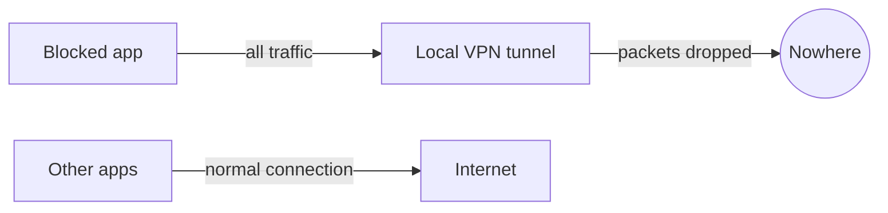

<div align="center">


<br/>


<a href="https://github.com/USERNAME/NetBlock">
  
</a>

<br/><br/>

[](https://github.com/USERNAME/NetBlock/releases/latest)
[](https://github.com/USERNAME/NetBlock/releases)
[](https://github.com/USERNAME/NetBlock/actions)
[](LICENSE)


<br/>

### [⬇️ Download the latest APK](https://github.com/USERNAME/NetBlock/releases/latest)

</div>

---

## Table of contents

- [What is Net Block?](#what-is-net-block)
- [Features](#features)
- [Download](#download)
- [How to use](#how-to-use)
- [How it works](#how-it-works)
- [Privacy](#privacy)
- [Requirements](#requirements)
- [Build from source](#build-from-source)
- [Project structure](#project-structure)
- [Limitations](#limitations)
- [Ideas for the future](#ideas-for-the-future)
- [Contributing](#contributing)
- [License](#license)

---

## What is Net Block?

Net Block is a small, fast Android firewall. Pick the apps you want to cut off, press one button, and those apps lose their internet connection. Every other app keeps working normally.

It uses Android's built-in VPN service as a local filter, so it needs **no root** and sends **no data anywhere**.

## Features

| | Feature | Details |
|---|---|---|
| 🎯 | **Per-app blocking** | Turn off the internet for only the apps you choose |
| ⚡ | **Instant apply** | Change a switch while blocking is on and it takes effect right away |
| 🔍 | **Search and filter** | Find any app fast; switch between *All apps* and *Blocked* |
| 💾 | **Remembers your choices** | Your blocked list survives restarts |
| 🪶 | **Lightweight** | Icons load only when visible, so long app lists scroll smoothly |
| 🌙 | **Modern dark UI** | Jetpack Compose with Material 3 |
| 🔒 | **Private by design** | The app has no internet permission at all |
| 🆓 | **Free and open source** | MIT licensed, no ads, no tracking |

<!--
Add screenshots here after you take them:

<p align="center">
  
  
</p>
-->

## Download

| Source | Link | Best for |
|---|---|---|
| **GitHub Releases** | [Latest release](https://github.com/USERNAME/NetBlock/releases/latest) | Most people. Stable, signed builds |
| **All releases** | [Release history](https://github.com/USERNAME/NetBlock/releases) | Older versions and changelogs |
| **Latest CI build** | [Actions → Build APK](https://github.com/USERNAME/NetBlock/actions/workflows/build.yml) | Testers. Open a run, then download the `NetBlock-apk` artifact |
| **Source code** | [Download ZIP](https://github.com/USERNAME/NetBlock/archive/refs/heads/main.zip) | Developers |

> **Installing for the first time?** Allow *Install unknown apps* for your browser or file manager. If you installed a different build before, uninstall it first, because builds signed with another key cannot be updated in place.

## How to use

1. Open Net Block and find the app you want to cut off.
2. Turn on its switch. It shows **Internet blocked**.
3. Press the big power button and accept the one-time VPN prompt.
4. To let an app online again, turn its switch off. To stop everything, press the power button again.

> Pressing the power button with no apps selected does nothing on purpose, because an empty VPN would capture every app.

## How it works



Net Block starts a local `VpnService` and routes **only the selected apps** into it with `addAllowedApplication()`. The tunnel reads those packets and discards them, so the blocked apps see a dead connection. Apps that are not selected never enter the tunnel and are not affected.

## Privacy

- **No internet permission.** Net Block cannot connect to any server, even if it wanted to.
- **No analytics, no ads, no accounts.**
- The VPN is local. Packets are dropped on your phone and never leave it.
- Only the list of blocked package names is stored, on your device.

## Requirements

- Android 8.0 (API 26) or newer
- No root

## Build from source

You need Android Studio (Koala or newer) with JDK 17.

```bash
git clone https://github.com/USERNAME/NetBlock.git
cd NetBlock
```

Then either open the folder in Android Studio and press **Run**, or build from the command line with Gradle 8.9+:

```bash
gradle assembleRelease
# APK: app/build/outputs/apk/release/app-release.apk
```

### Publish your own release

Push a version tag and GitHub Actions builds the APK and attaches it to a new release:

```bash
git tag v1.0.0
git push origin v1.0.0
```

## Project structure

```
NetBlock/
├── app/src/main/java/com/zihad/netblock/
│   ├── MainActivity.kt        # Entry point, VPN permission flow
│   ├── BlockVpnService.kt     # Local VPN that drops blocked traffic
│   ├── AppsViewModel.kt       # Loads the app list, holds blocked set
│   ├── Prefs.kt               # Saves the blocked list
│   └── ui/
│       ├── HomeScreen.kt      # Status card, search, filters, app list
│       ├── AppIcon.kt         # Lazy icon loading with cache
│       └── Theme.kt           # Colors and typography
├── assets/                    # Logo and banner
└── .github/workflows/         # CI build and release automation
```

## Limitations

- Android allows **one VPN at a time**. Starting another VPN app turns Net Block off.
- Blocking applies to both Wi-Fi and mobile data. Per-network rules are not available yet.
- Some manufacturers aggressively close background apps. If blocking stops, exclude Net Block from battery optimization.

## Ideas for the future

- [ ] Separate Wi-Fi and mobile-data rules
- [ ] Schedules, for example block at night
- [ ] Light theme
- [ ] Quick Settings tile
- [ ] Bengali and other translations

Have an idea? [Open an issue](https://github.com/USERNAME/NetBlock/issues).

## Contributing

Contributions are welcome.

1. Fork the repository
2. Create a branch: `git checkout -b feature/my-feature`
3. Commit your changes: `git commit -m "Add my feature"`
4. Push the branch and open a pull request

Please keep changes focused and test on a real device, since VPN behavior differs from emulators.

## License

Released under the [MIT License](LICENSE).

---

<div align="center">

Made with ❤️ by [Zihad](https://github.com/USERNAME)

If Net Block helps you, a ⭐ on the repo means a lot.


</div>
